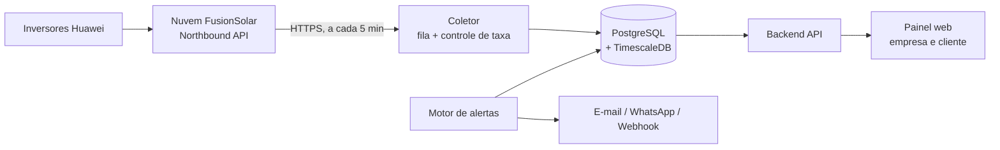

# Solar Monitor

Plataforma web para empresas de energia solar acompanharem a geração das usinas de seus clientes, com inversores **Huawei**, e para os consumidores finais verem quanto a própria usina está gerando e quanto isso representa em economia.

> **Status do projeto: planejamento e esqueleto de código.**
> Este repositório reúne o desenho do sistema e um esqueleto inicial do coletor Huawei, das regras de alerta e do esquema do banco. Os testes unitários passam, mas o sistema **nunca foi executado contra a API real da Huawei nem contra um banco em funcionamento**. Os endpoints, campos e limites da API da Huawei devem ser validados contra a documentação oficial da versão usada pela empresa antes de qualquer uso real.

---

## Sumário

- [Objetivo](#objetivo)
- [Público e perfis de acesso](#público-e-perfis-de-acesso)
- [Funcionalidades](#funcionalidades)
- [Como os dados chegam](#como-os-dados-chegam)
- [Stack prevista](#stack-prevista)
- [Arquitetura em resumo](#arquitetura-em-resumo)
- [Estrutura prevista do repositório](#estrutura-prevista-do-repositório)
- [Configuração](#configuração)
- [Testes](#testes)
- [Ambiente de referência (Oracle Cloud Always Free)](#ambiente-de-referência-oracle-cloud-always-free)
- [Roteiro](#roteiro)
- [Riscos e limitações](#riscos-e-limitações)
- [Privacidade e LGPD](#privacidade-e-lgpd)
- [Documentação](#documentação)
- [Licença](#licença)

---

## Objetivo

Mostrar, de forma simples e confiável:

- quanta energia cada usina está gerando agora (kW) e já gerou (kWh) no dia, no mês, no ano e no total;
- quanto isso representa em economia estimada (R$);
- se o sistema está funcionando bem, com alertas de falha e queda de desempenho.

## Público e perfis de acesso

O sistema é **multi-empresa (multi-tenant)**: cada empresa enxerga apenas seus próprios dados.

| Perfil | O que faz |
|---|---|
| **Administrador da empresa** | Cadastra clientes e usinas, vincula contas Huawei, gerencia usuários e tarifas |
| **Técnico / O&M** | Acompanha a carteira de usinas, trata alertas e chamados |
| **Cliente final** | Vê somente a(s) própria(s) usina(s), com a identidade visual da empresa (white-label) |

## Funcionalidades

**MVP**
- Cadastro de empresa, clientes e usinas, com vínculo à conta de API da Huawei
- Painel da carteira: geração total, usinas offline e ranking de desempenho
- Tela da usina: potência atual, geração por hora, dia, mês e ano, economia estimada
- Alertas básicos: inversor offline, comunicação perdida, geração zerada em horário de sol
- Área do cliente final

**Fase 2**
- Geração prevista × real e indicador de desempenho
- Relatório mensal em PDF por cliente
- Abertura de chamados e integração com ERP/CRM
- Notificações por e-mail e WhatsApp

**Fase 3**
- Previsão de geração por clima e detecção de anomalias (sujeira, sombreamento, degradação)
- Consumo da casa e energia injetada na rede (depende de medidor instalado)
- Suporte a outras marcas de inversor

## Como os dados chegam

Os dados vêm da **Northbound API (OpenAPI) da plataforma Huawei FusionSolar (SmartPVMS)**. A comunicação é de nuvem para nuvem: o servidor do projeto consulta a Huawei por HTTPS, sem precisar de nada instalado na usina.

Pontos que moldam o projeto:

- A conta de API é criada no portal FusionSolar, em *System → Company Management → Northbound Management*, com permissões por tipo de dado.
- Os dados em tempo real são atualizados pela Huawei a cada **5 minutos**; consultar com mais frequência não traz informação nova.
- A API tem **cotas de chamadas**, que dependem da quantidade de usinas e dispositivos da conta de API e da data de criação dela, além de limitar a uma sessão de login por vez.
- Por isso, **um único serviço coletor** faz todas as chamadas, com fila e controle de taxa. O painel nunca consulta a Huawei diretamente: lê do banco do projeto.

Detalhes em [`docs/ARQUITETURA.md`](docs/ARQUITETURA.md).

## Stack prevista

| Camada | Tecnologia |
|---|---|
| Coletor e backend | Python (FastAPI) |
| Fila e agendamento | Agendador interno + fila em PostgreSQL (evolui para Redis se necessário) |
| Banco de dados | PostgreSQL + TimescaleDB (séries temporais) |
| Frontend | React (web responsivo) |
| Empacotamento | Docker e Docker Compose (imagens multi-arquitetura, `amd64` e `arm64`) |
| Segredos | Variáveis de ambiente em desenvolvimento; cofre de segredos em produção |
| Observabilidade | Logs estruturados, métricas Prometheus, painel Grafana |

## Arquitetura em resumo



## Estrutura prevista do repositório

```text
solar-monitor/
├── README.md
├── .env.example
├── docs/
│   ├── ARQUITETURA.md              # desenho técnico detalhado
│   └── decisoes/                   # registros de decisões de arquitetura (ADRs)
├── backend/
│   ├── app/                        # API (FastAPI): hoje só /health e o cálculo de economia
│   ├── collector/                  # coletor Huawei
│   │   ├── huawei_client.py        #   sessão única, renovação de login, erros 305/407
│   │   ├── rate_limiter.py         #   balde de fichas por endpoint
│   │   ├── providers/              #   interface por marca + provedor Huawei
│   │   ├── service.py              #   ciclo de coleta e soma de potência por usina
│   │   ├── store.py                #   gravação idempotente no banco
│   │   └── main.py                 #   laço de 5 em 5 minutos
│   ├── alerts/                     # regras de alerta (funções puras)
│   ├── tests/                      # testes unitários
│   ├── Dockerfile
│   └── requirements*.txt
├── db/migrations/
│   ├── 001_init.sql                # esquema (PostgreSQL + TimescaleDB)
│   └── 002_rls.sql                 # esboço de Row Level Security (não aplicado)
└── deploy/
    └── docker-compose.yml          # banco, API e coletor
```

> Ainda faltam: frontend, motor de alertas em execução, autenticação, rotas da API, proxy HTTPS e monitoramento.

## Configuração

Copie `.env.example` para `.env` e preencha (nenhum segredo real deve ir para o repositório). Exemplo:

```dotenv
# Banco de dados
DATABASE_URL=postgresql://solar:CHANGE_ME@db:5432/solar

# Huawei FusionSolar (um conjunto por conta de API, guardado de forma segura)
HUAWEI_BASE_URL=https://<servidor-regional>.fusionsolar.huawei.com
HUAWEI_API_USER=CHANGE_ME
HUAWEI_API_SYSTEM_CODE=CHANGE_ME

# Coleta
COLLECT_REALTIME_INTERVAL_MINUTES=5
COLLECT_DAILY_REPORTS_HOUR_UTC=3

# Aplicação
JWT_SECRET=CHANGE_ME
APP_ENV=development
```

O endereço regional da API depende da conta (por exemplo, `intl`, `eu5`, `au5`), então deve ser confirmado no login da própria conta FusionSolar.

## Testes

Os testes usam apenas a biblioteca padrão do Python (`unittest`), sem rede e sem banco:

```bash
cd backend
python3 -m unittest discover -s tests -t . -v
```

Cobrem o controle de taxa, o cliente Huawei (login, renovação de sessão, erros 305 e 407), a leitura das respostas da Huawei, o ciclo de coleta, as regras de alerta, o cálculo de economia e o agendamento. Não cobrem o acesso ao banco (`store.py`) nem a chamada real à API.

## Ambiente de referência (Oracle Cloud Always Free)

O projeto foi pensado para rodar, em demonstração, em uma VM Arm do plano **Always Free** da Oracle Cloud.

- Limite atual divulgado: **2 OCPUs e 12 GB de RAM** no total para VMs Ampere A1 (antes eram 4 OCPUs e 24 GB). Confirme o limite no console da sua conta.
- Exige cartão no cadastro, e contas ociosas por muito tempo podem ser removidas.
- Pode ocorrer falta de capacidade ao criar a VM Arm.
- **Não é recomendado para produção da empresa:** as regras do plano já mudaram uma vez sem muito aviso. Em produção, usar uma VM paga na mesma nuvem; como tudo roda em Docker, a migração não exige mudança no código.

## Roteiro

| Etapa | Duração estimada | Entrega |
|---|---|---|
| 1. Descoberta | 2 semanas | Conta de API, servidor regional, número de usinas, telas principais |
| 2. Prova de conceito | 2 semanas | Conector lendo 2 ou 3 usinas reais, medição das cotas da API |
| 3. MVP | 8 semanas | Coletor, banco, painel, alertas, multi-tenant |
| 4. Piloto | 4 semanas | 10 a 20 usinas, comparação com o app oficial da Huawei |
| 5. Expansão | contínuo | Relatórios, integrações, novas marcas |

## Riscos e limitações

- **Cotas da API da Huawei** podem limitar o número de usinas ou a frequência de coleta.
- **Dependência da nuvem da Huawei:** se ela ficar indisponível, não há dados novos. O sistema guarda o histórico e sinaliza o atraso.
- **Valores em R$ são estimativas.** Não substituem a fatura da distribuidora.
- **Autorização dos clientes:** a empresa precisa de autorização para acessar os dados de cada usina.
- **Plano gratuito da Oracle** serve para demonstração, não para operação.

## Privacidade e LGPD

Dados de geração e consumo ligados a uma pessoa são dados pessoais. Na relação com a empresa cliente, a empresa é a **controladora** e este sistema é o **operador**. O projeto prevê: isolamento de dados por empresa, controle de acesso por perfil, registro de acessos, criptografia em trânsito e das credenciais em repouso, e política de retenção e exclusão de dados.

## Documentação

- [Arquitetura detalhada](docs/ARQUITETURA.md)

## Licença

A definir.
